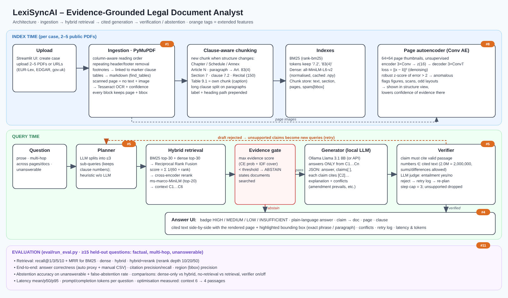

# LexiSyncAI – Evidence-Grounded Legal Document Analyst

Final assignment DA3 – Deep Learning & GenAI (Prof. Dr. Gayan de Silva).

**GitHub:** https://github.com/hamzakazi511-eng/LexiSyncAI

LexiSyncAI ingests a bundle of 2–5 public legal PDFs (contracts, statutes, judgments, filings) and answers complex questions about them.
- Every claim in an answer is cited to **document · page · clause**, and the cited region is highlighted on the page image.
- When the documents do not contain the evidence, the system **abstains** instead of guessing.



---

## 1. Quick start

```bash
# 1) dependencies (Python 3.11+; OCR needs the tesseract binary: apt install tesseract-ocr / brew install tesseract)
make install

# 2) models: embedder + cross-encoder (Hugging Face) and a local LLM (Ollama, https://ollama.com)
make models                     # = ollama pull llama3.1:8b (+ HF downloads)

# 3) run the app (also generates the synthetic sample bundle)
make run                        # http://localhost:8501
```

**One command with Docker** (app + Ollama, model pulled automatically): `docker compose up --build`.

**No GPU or too little RAM?** Use a smaller local model (`LEXI_OLLAMA_MODEL=llama3.2:3b`), or any OpenAI-compatible API, e.g. the Groq free tier or a free Oracle Cloud VM running Ollama:

```bash
export LEXI_LLM_BACKEND=openai OPENAI_BASE_URL=https://api.groq.com/openai/v1 OPENAI_API_KEY=... LEXI_OPENAI_MODEL=llama-3.1-8b-instant
```

`LEXI_LLM_BACKEND=extractive` runs without any LLM, using sentence selection. This is useful offline, but it is not the graded generative path.

Other commands:

| command | what it does |
|---|---|
| `make test` | 19 unit and pipeline tests (ingestion, chunking, retrieval, grounding, verifier loop, metrics, autoencoder) |
| `make eval` | full evaluation on the sample bundle → `results/samples/eval_report.md` |
| `make eval-gdpr` | evaluation on the GDPR (put the EUR-Lex PDF, CELEX 32016R0679, into `data/gdpr/`) |

Reproducibility:
- Dependencies are pinned in `requirements.txt`.
- The seed is fixed with `LEXI_SEED=42`. It is applied to Python, NumPy, Torch, the Ollama `seed` option and temperature 0.
- The Docker image bakes in the retrieval models.

---

## 2. Application flow (matches the brief)

1. **Create a case** in the sidebar, then upload 2–5 PDFs or paste URLs (EUR-Lex, SEC EDGAR, gov.uk, CourtListener).
2. **Index.** The *Structure* tab then shows the following for every page: characters, columns, tables, scanned flag, OCR confidence, autoencoder anomaly score and removed headers/footers. It also lists the detected sections and clauses (`Article 83(4)`, `Section 7.2`, `Table 9.1` …) and shows thumbnails of flagged pages.
3. **Ask.** Example: *"Does the liability cap in Section 7 exceed the total indemnity obligations in Section 9?"*
4. **Answer.** Example: *"No. The Section 7.2 cap is EUR 2,000,000 (p. 4); the Section 9 indemnities total EUR 3,500,000 (Table 9.1, p. 4)."*
5. **Citations.** Each claim lists document · page · clause, with the quoted text **side by side** with the rendered page and a highlighted box.
   - 🟧 = exact phrase box.
   - 🟦 = paragraph box.
6. **Confidence badge:** HIGH / MEDIUM / LOW / INSUFFICIENT EVIDENCE.
7. **Generative explanation and conflicts.** Example: *"Amendment No. 1 §2.2 (p. 1) amends MSA §7.2 (p. 4); the amendment is later in time and prevails."*
8. **Unanswerable follow-up.** For *"What is the governing law of the subcontractor agreement?"* the system abstains and lists the documents it searched.

The *Pipeline details* expander shows:
- the search plan;
- the verifier retry log;
- the retrieved context, with BM25, dense and rerank ranks for each passage;
- latency and token counts.

---

## 3. Core technical requirements → implementation

| Requirement | Where | How |
|---|---|---|
| **Ingestion and extraction:** reading order, headers, footers, footnotes, scanned pages | `lexisync/ingest.py` | See [Ingestion details](#ingestion-details) below. |
| **Clause/section-aware chunking** (not fixed-size) | `lexisync/chunking.py` | See [Chunking details](#chunking-details) below. |
| **Hybrid retrieval and reranking** | `lexisync/retrieval.py` | See [Retrieval details](#retrieval-details) below. Recall@k is reported per configuration. |
| **Generative answer with page-level citations** | `lexisync/answer.py`, `lexisync/llm.py` | See [Generation details](#generation-details) below. |
| **Abstention** | `answer.py` | Three layers: (1) evidence gate on the best evidence score; (2) the generator's `insufficient` flag; (3) no claim survives verification. Abstention accuracy is reported on the unanswerable questions, together with the false-abstention rate. |
| **Evaluation** | `eval/run_eval.py`, `eval/questions_*.json` | See [§5](#5-evaluation). |

### Ingestion details
- **Reading order:** column-aware. Full-width blocks split the page into bands, and the left column is read before the right one.
- **Headers and footers:** blocks in the top or bottom 8% of a page whose number-normalised text repeats on at least 50% of pages are removed, along with page numbers.
- **Footnotes:** detected by small font, low position on the page and a leading marker. Each footnote is attached to the clause that carries its marker.
- **Tables:** extracted with `find_tables`. Cells are read by bounding box to keep spaces, and spanning headers are filled across. Each table becomes markdown.
- **Scanned pages:** a page with almost no text but an image is flagged as scanned, then OCR'd with Tesseract.
- **Bounding boxes:** every block keeps its bbox, for the highlighted citations.

### Chunking details
- A new chunk starts at each Chapter/Part/Schedule/Annex, Article, Section or clause (`7.2`), GDPR paragraph (`4.` inside Article 83 → `Article 83(4)`) and Recital.
- Tables get their own chunks, labelled by their caption.
- Long clauses are split at paragraph boundaries and keep their label.
- The heading path is prepended to the text, so `Section 7.2` is itself searchable.

### Retrieval details
- **BM25 tokenizer:** keeps `7.2` and `83(4)` whole and also splits them.
- **Dense embeddings:** `all-MiniLM-L6-v2`.
- **Fusion:** **Reciprocal Rank Fusion**, `Σ 1/(60+rank)`.
- **Reranking:** cross-encoder `ms-marco-MiniLM-L-6-v2` on the top 20.

### Generation details
- **Model:** local LLM through Ollama (default `llama3.1:8b`).
- **Output:** strict JSON with `answer`, `claims[{text, cite:[C2]}]`, `explanation` and `conflicts`.
- **Grounding:** citation ids are mapped back to document · page · clause · bbox. Claims without a valid citation are dropped.
- **Conflicts:** the prompt asks the model to report both values and which one prevails. A deterministic amendment-conflict detector adds a note when an amendment and the clause it changes are both in context.

---

## 4. Extended features implemented (5 of 11)

| # | Feature | What is shown |
|---|---|---|
| **1** | OCR for scanned pages | Image-only pages are detected (`scanned`). Tesseract adds per-word bboxes and a mean OCR confidence, shown in the structure view (0.95 on the sample signature page). If Tesseract is missing, the page stays flagged and is reported. Answers based on OCR text get at most MEDIUM confidence. |
| **4** | Bounding-box citations on the page image | `grounding.best_regions()` picks the paragraph boxes inside the cited chunk that support the claim, then tightens them to the exact amount or number with `page.search_for` (🟧). The evaluation reports **region-level citation precision**: the share of highlighted boxes that overlap the gold evidence region. |
| **5** | Planner + verifier agent loop | See [Verifier loop](#verifier-loop) below. |
| **8** | Autoencoder component | `anomaly.py`, a convolutional **denoising autoencoder** on 64×64 page thumbnails. See [Page-anomaly autoencoder](#page-anomaly-autoencoder) below. |
| **11** | Latency and cost report | Per-stage timings (plan, retrieve, generate, verify) and prompt and completion tokens for every question, in the UI and in the evaluation. The evaluation reports mean, p50 and p95 latency, tokens per question and cost (`--price-in/--price-out`). **Measured optimisation:** shrinking the LLM context from 6 to 4 passages, compared on tokens, latency and quality. The cross-encoder rerank depth (10/20/50) is also compared on recall and latency. |

### Verifier loop
- **Planner:** decomposes the question into at most 3 sub-queries.
- **Deterministic check:** every number in a claim must appear in the cited text after normalisation (`2.0M` = `2,000,000` = "two million"). Sums and differences of cited numbers are allowed, e.g. a fee increase.
- **LLM judge:** checks entailment between each claim and its cited text.
- **On rejection:** the rejected draft is logged with its reason, the unsupported claims become new queries, the context grows, and the generator gets the verifier's feedback.
- **Step cap:** 3. After that, unsupported claims are dropped; if none survive, the system abstains.
- **Where to see it:** the UI shows the retry log; `tests/test_pipeline.py` demonstrates a rejected hallucinated number followed by a corrected draft.

### Page-anomaly autoencoder
- **Architecture:** Conv(1→16→32→32, stride 2) → z ∈ ℝ¹⁶ → ConvTranspose.
- **Training:** unsupervised on the case's own pages.
- **Score:** a page is flagged when the robust z-score (median/MAD) of its reconstruction error ‖x − x̂‖² is above 2.
- **What it catches:** figure pages, scans and unusual layouts. The chart page in the sample bundle scores z = 19.8; normal text pages score below 1.1.
- **Use:** flagged pages appear in the structure view and lower the confidence of evidence taken from them.

Not implemented: #2 (accuracy evaluation of table extraction; table extraction itself is part of the core), #3 (VLM chart reading), #6 (fine-tuned reranker), #7 (ablation table), #9 (full multi-document reconciliation; only amendment-conflict notes) and #10 (public deployment). For #10, the Dockerfile runs as-is on Hugging Face Spaces (Docker SDK) with `LEXI_LLM_BACKEND=openai`.

---

## 5. Evaluation

`eval/questions_sample.json` contains **19 held-out questions** on the sample bundle:
- 10 factual, including one OCR question and one footnote question;
- 5 multi-hop, across two pages or two documents, including a table, an amendment conflict and a computed difference;
- 4 unanswerable.

`eval/questions_gdpr.json` contains 12 questions on the GDPR, including the brief's Article 83(4)/(5) example.

Gold evidence is given as a short phrase (or a clause label). Gold pages and regions are resolved automatically from the ingested text, which also works for OCR pages.

`make eval` writes `results/<bundle>/eval_report.md` with:

1. **Retrieval:** recall@1/3/5/10 and MRR for BM25, dense, hybrid (RRF) and hybrid + cross-encoder. It also compares rerank depth 10/20/50 when the cross-encoder is available.
2. **End-to-end:**
   - answer correctness, as an automatic keyword/number proxy plus a manual column in `manual_grading.csv`;
   - citation precision and recall;
   - region precision;
   - abstention accuracy;
   - false-abstention rate.
3. **Mandatory comparison:** dense-only vs hybrid. With an LLM backend, a **no-retrieval vs retrieval** row is added automatically. A verifier on/off row is also included.
4. **Latency and cost** (feature #11), a per-question table and the verifier retry log.

### Results (Llama 3.1 8B via Ollama, MiniLM + cross-encoder, sample bundle, seed 42)

**Retrieval** (page-level recall@k over the 15 answerable questions):

| config | recall@1 | recall@3 | recall@5 | recall@10 | MRR | latency (ms) |
|---|---|---|---|---|---|---|
| BM25 | 0.800 | 0.933 | 1.000 | 1.000 | 0.967 | 1 |
| Dense (MiniLM) | 0.867 | 0.967 | 1.000 | 1.000 | 1.000 | 13 |
| Hybrid (RRF) | 0.800 | 1.000 | 1.000 | 1.000 | 0.967 | 9 |
| **Hybrid + cross-encoder (depth 20)** | **0.867** | 0.933 | 1.000 | 1.000 | **1.000** | 671 |
| Hybrid + cross-encoder (depth 10) | 0.867 | 0.933 | 1.000 | 1.000 | 1.000 | 139 |
| Hybrid + cross-encoder (depth 50) | 0.867 | 0.933 | 1.000 | 1.000 | 1.000 | 1121 |

**End-to-end** (19 questions; answer correctness = automatic keyword/number proxy, manual grade in
`results/samples/manual_grading.csv`):

| config | correct | factual | multi-hop | citation precision | citation recall | region precision | abstention acc. | false abstention |
|---|---|---|---|---|---|---|---|---|
| **Full: hybrid + rerank + planner + verifier** | **0.800** | 0.900 | 0.600 | **1.000** | 0.900 | 0.833 | 0.750 | 0.000 |
| Dense-only (+ planner + verifier) | 0.533 | 0.800 | 0.000 | 1.000 | 0.867 | 0.733 | 0.500 | 0.000 |
| Hybrid + rerank, NO verifier | 0.733 | 0.900 | 0.400 | 0.967 | 0.900 | 0.789 | 0.750 | 0.000 |
| Full, context 4 passages (optimisation) | 0.667 | 0.800 | 0.400 | 1.000 | 0.867 | 1.000 | 1.000 | 0.000 |
| **NO retrieval (LLM only)** | 0.133 | 0.200 | 0.000 | – | 0.000 | – | 0.000 | 0.000 |

**Latency and cost (feature #11)** – local model, so cost = 0 USD:

| config | mean s | p50 s | p95 s | prompt tok/q | completion tok/q | context tok/q | verifier retries |
|---|---|---|---|---|---|---|---|
| Full | 12.0 | 12.0 | 21.0 | 1306 | 185 | 500 | 2 |
| Dense-only | 9.6 | 9.4 | 17.0 | 1280 | 179 | 449 | 2 |
| NO verifier | 8.1 | 8.5 | 9.5 | 923 | 133 | 494 | 0 |
| Context 4 | 12.0 | 11.0 | 21.0 | 1264 | 189 | 395 | 5 |
| NO retrieval | 4.3 | 4.3 | 5.3 | 96 | 147 | 0 | 0 |

**Manual grading** (`results/samples/manual_grading.csv`): **15/19 = 0.789** overall · factual 9/10 · multi-hop 3/5 · unanswerable 3/4 abstained. Consistent with the automatic proxy (0.80).

**Findings**

1. **Retrieval is essential (mandatory comparison):** the LLM alone answers 13 % correctly and never abstains – it
   guesses. With retrieval: 80 %, every cited page is a gold evidence page (citation precision 1.0).
2. **Hybrid beats dense-only (mandatory comparison):** 0.80 vs 0.53 correct, 0.60 vs 0.00 on multi-hop. BM25 catches
   exact identifiers ("Section 7.2", "EUR 2,000,000") that the dense model blurs; RRF fuses both.
3. **Cross-encoder reranking** raises recall@1 from 0.80 to 0.87 and MRR to 1.0. **Measured optimisation:** rerank
   depth 10 instead of 50 is ~8x faster (1121 -> 139 ms) with identical recall.
4. **Planner + verifier loop:** +7 points correctness and citation precision 0.967 -> 1.000, for ~3.5 s and ~380 extra
   prompt tokens per question. The retry log shows real catches, e.g. M01: the first draft claimed the Section 7
   cap *exceeds* the indemnities; the LLM judge rejected it (2,000,000 < 3,500,000), the retry answered correctly.
5. **Context size trade-off:** 4 instead of 6 passages saves 21 % context tokens and gives perfect abstention, but
   multi-hop correctness drops (0.60 -> 0.40) because the second hop's passage is cut off.
6. **Error analysis (full system):** F10 (footnote: the base-rate footnote is retrieved but the answer omits
   "Bundesbank"), M02 (fee increase needs arithmetic on two documents), M04 (two-part answer, one part missing) and
   U03 (asked for Nordwind's Data Protection Officer: answered from the DPA's controller/processor clauses instead of
   abstaining – the term "officer" exists in no document, but the question names a known party, so the gate did not
   fire). These are the next improvements: explicit arithmetic tool, per-sub-question answer check, stricter
   entity/role check for abstention.

`results/samples_offline_extractive/` additionally contains a no-LLM baseline run (LSA fallback, extractive answers).

---

## 6. 5-minute demo script

1. **(30 s) Architecture.** Show the one-page diagram (`docs/architecture.png`).
2. **(45 s) Setup.** Create a case, upload the given unseen PDF (plus 1–2 related PDFs), click **Index**, then open **Structure**. Point out the sections and clauses found, tables, scanned and anomalous pages, and removed headers.
3. **(60 s) Prose question.** Show the answer, the badge, the citation next to the highlighted page, and the explanation.
4. **(60 s) Two-page multi-hop question.** Open *Pipeline details* and show the search plan (one query per clause), the ranks (BM25, dense, rerank), the verifier log, and any conflict note.
5. **(45 s) Unanswerable question.** Show the INSUFFICIENT EVIDENCE badge and the list of documents searched.
6. **(40 s) Evaluation tab.** Show recall@k per configuration, dense vs hybrid, abstention accuracy and latency.

---

## 7. How the design maps to the lectures (for the theory Q&A)

| Lecture | Where it appears |
|---|---|
| **RAG and vector DBs** | <ul><li>Two-stage retrieval: *candidate retrieval maximises recall* (BM25 + dense, top 30 each), then *reranking maximises precision* (cross-encoder on the top 20).</li><li>Hyperparameters: chunk size (clause-based), overlap (none, because clause boundaries are semantic) and embedding size (384).</li><li>Query/document mismatch is mitigated by prepending the heading path ("contextualised chunks") and by the planner's sub-queries.</li><li>Metrics: recall@k, precision, MRR.</li></ul> |
| **Transformers** | <ul><li>The bi-encoder (MiniLM) embeds the query and the chunk *separately*; their cosine similarity is fast and can be pre-computed.</li><li>The cross-encoder runs self-attention over *[query; chunk] jointly*. That is more accurate but O(n) forward passes, so it is used only for reranking.</li><li>The generator is a decoder-only LLM.</li><li>Scaled dot-product attention: softmax(QKᵀ/√d)V.</li></ul> |
| **Agentic AI** | <ul><li>Planner → tool (retriever) → generator → verifier, a ReAct-style loop with a step cap.</li><li>Safety recommendations applied: clear scope (answer only from documents), fail-safe (abstain), state tracking and logging (retry log), output filtering (hallucination check).</li></ul> |
| **Autoencoders** | Encoder–latent–decoder trained to reconstruct pages; the reconstruction error is the anomaly score. Training is unsupervised, so no labels are needed. |
| **CNN** | The autoencoder is convolutional: stride-2 convolutions downsample and transposed convolutions upsample. |
| **Optimisation** | <ul><li>Adam, MSE loss, weight decay.</li><li>The denoising input noise acts as data augmentation.</li><li>Fixed seeds.</li><li>ReLU activations with a sigmoid output (pixels lie in [0, 1]).</li></ul> |
| **Multimodal** | Text plus the page image: the OCR path for scanned pages, and page rendering for bounding-box grounding. |

**Why hybrid?** BM25 is exact on identifiers ("Section 7.2", "Article 83(4)", "EUR 2,000,000") but misses paraphrases. Dense retrieval matches meaning ("cap" ↔ "aggregate liability shall not exceed") but blurs numbers. RRF fuses their *ranks*, so it is scale-free.

**Why abstain?** In legal work, an unsupported answer is worse than none. Three independent signals decide (retrieval evidence, generator self-assessment and verifier survival), and the system always states which documents it searched.

**When sources conflict:** the system reports both values with citations. A later amendment, or an explicit precedence clause ("this Amendment prevails"), wins, and confidence is capped at MEDIUM.

---

## 8. Project layout

```
app.py                     Streamlit UI (upload → index → structure → ask → cited answer → evaluation)
lexisync/
  config.py                settings (env-overridable), seeding
  ingest.py                PDF parsing, reading order, headers/footers/footnotes, tables, scanned + OCR
  chunking.py              clause/section-aware chunks with page + bbox spans
  retrieval.py             BM25, dense, RRF, cross-encoder, evidence score, missing-term check
  llm.py                   Ollama / OpenAI-compatible backends
  answer.py                planner → retrieve → gate → generate → verify/retry → confidence
  grounding.py             number normalisation, numeric support check, bounding-box regions
  anomaly.py               convolutional page autoencoder
  metrics.py               recall@k, MRR, citation/region precision, keyword correctness
  store.py                 cases, persistence, page rendering with highlights
eval/run_eval.py           evaluation harness; questions_sample.json, questions_gdpr.json
scripts/make_sample_docs.py  synthetic, fictional 3-PDF bundle (MSA, amendment, DPA)
tests/                     pytest suite (fake LLM for the verifier loop)
docs/architecture.(svg|png)  one-page architecture diagram
```

### Known limitations
- Reading order handles one or two columns, not complex magazine layouts.
- Table extraction depends on ruling lines, so borderless tables become plain text.
- Bounding boxes are at paragraph level unless an exact number or phrase match is found.
- Abstention thresholds (`LEXI_ABSTAIN_T`) were tuned on the sample set and should be re-checked on the GDPR set.
- The sample bundle is synthetic and fictional. Evaluate on real public documents as well (GDPR question set provided).
